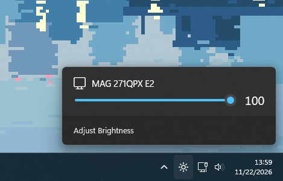
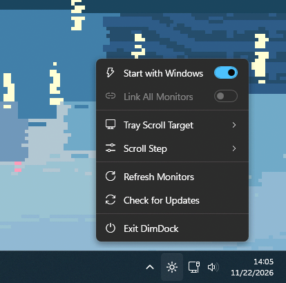

# DimDock

[](https://github.com/ohivan/dimdock/releases/latest)
[](https://github.com/ohivan/dimdock/releases)
[](https://github.com/ohivan/dimdock/actions/workflows/ci.yml)

[](./LICENSE)

Windows 11 system tray utility for controlling external monitor brightness over hardware DDC/CI.

**Website:** [dimdock.app](https://dimdock.app)

> [!NOTE]
> **External monitors only:** DimDock is for desktop setups with external DDC/CI monitors and does not control built-in laptop displays.

> [!NOTE]
> None of the code in this repository was written by hand; the project was built entirely with Gemini 4 Neon.

<p align="left">
  
  
</p>

## Overview

- **Hardware DDC/CI**: Controls the monitor's actual backlight rather than applying a software overlay, with throttled writes and automatic wake/display rescanning.
- **Taskbar controls**: Left-click the tray icon for the Fluent Acrylic flyout, right-click for settings, or scroll directly over the icon in 1%, 2%, 5%, or 10% steps.
- **Multi-monitor**: Adjust monitors independently or link them together, with configurable tray scroll targets.
- **Native Windows 11**: Matches system theme and accent color, uses a DPI-aware sun icon that reflects brightness, and ships as a single NativeAOT Win32/Direct2D executable (zero .NET runtime dependency, minimal RAM footprint, zero telemetry).
- **Startup & updates**: Optional *Start with Windows* toggle and automatic updates via Velopack.

## Install

Requires Windows 11 (x64) and external monitor(s) with **DDC/CI** enabled in the monitor's OSD menu.

```powershell
winget install ohivan.DimDock
```

Or download `DimDock-win-Setup.exe` from [GitHub Releases](https://github.com/ohivan/dimdock/releases/latest).

## Development

Requires the [.NET 10 SDK](https://dotnet.microsoft.com/) (and [Bun](https://bun.sh/) for [`web/`](./web)).

```powershell
dotnet build DimDock.slnx
dotnet test DimDock.slnx
dotnet run --project src/DimDock
```

- [`src/DimDock`](./src/DimDock): NativeAOT Win32/Direct2D tray app (`Interop/` Win32 & Direct2D/DirectWrite COM, `Services/` DDC/CI backend & settings/updater, `UI/` Acrylic flyout & Fluent tray menu)
- [`tests/DimDock.Tests`](./tests/DimDock.Tests): xUnit tests for controller concurrency, Win32 interop, placement, easing, settings, and updater
- [`web`](./web): Static project website (`cd web && bun run dev`; see [`web/README.md`](./web/README.md))

## Troubleshooting

- **Monitor not detected**: Verify **DDC/CI** is enabled in the monitor's OSD settings. Some HDMI/DisplayPort docks or KVMs block I2C/DDC traffic.
- **Laptop screen not listed**: DimDock only supports external DDC/CI monitors, not built-in laptop displays.
- **Settings**: `%LocalAppData%\DimDock\settings.json`
- **Log**: `%LocalAppData%\DimDock\dimdock.log`

## License

[MIT](./LICENSE)
